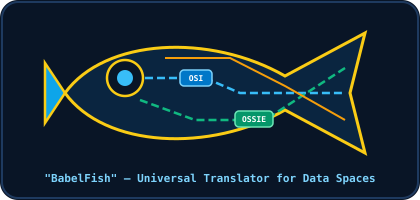
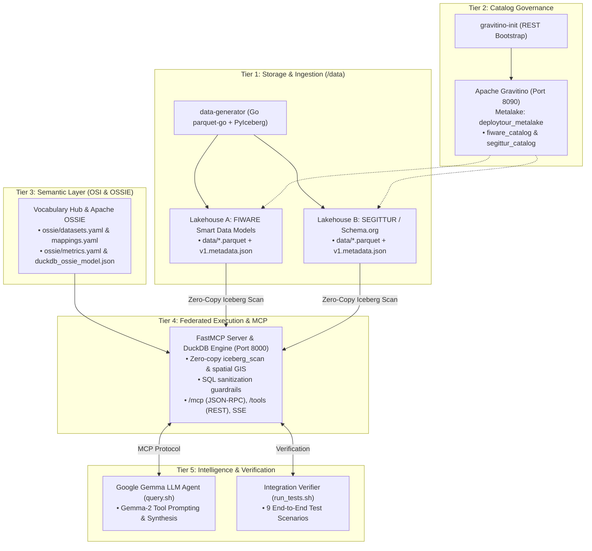

<!--
Copyright 2024-2026 Universidad Politécnica de Madrid / Deploytour

Licensed under the Apache License, Version 2.0 (the "License");
you may not use this file except in compliance with the License.
You may obtain a copy of the License at

    http://www.apache.org/licenses/LICENSE-2.0

Unless required by applicable law or agreed to in writing, software
distributed under the License is distributed on an "AS IS" BASIS,
WITHOUT WARRANTIES OR CONDITIONS OF ANY KIND, either express or implied.
See the License for the specific language governing permissions and
limitations under the License.
-->

# DEPLOYTOUR & UPM: OSI-Based Semantic Solution

**A "BabelFish" for Federated Tourism Data Spaces** — deterministic, real-time semantic interoperability without moving or centralizing source databases.



This repository hosts the containerized, local-first Proof of Concept (PoC) developed by **Universidad Politécnica de Madrid (UPM)** for **DEPLOYTOUR**. It demonstrates how Destination Management Organizations (DMOs) and AI agents can compute cross-domain sustainability KPIs (such as the **Tourism Pressure Index**) across sovereign, incompatible data silos:

1. **Lakehouse A — FIWARE Smart Data Models (Hotels / Supply):** Physical accommodation infrastructure, bed capacity, and occupancy (`TouristDestination`, `Accommodation`).
2. **Lakehouse B — SEGITTUR / Schema.org (City / Demand):** Tourist points of interest, visitor footfall, and daily expenditure (`PuntoDeInteresTuristico`, `DestinoTuristicoFlujo`).

---

## Quick Start: How to Start and Use the Project

> **Prerequisites:** Only **Docker** and **Docker Compose** are required. No local Go, Python, or DuckDB installation is needed.

### 1. Start the Infrastructure
Build and launch the data generator, Apache Gravitino catalog, and the DuckDB + FastMCP server in the background:

```bash
./start_infra.sh
```

Once healthy, the services are available at:
- **MCP Server & DuckDB Engine:** `http://localhost:8000` (JSON-RPC: `POST /mcp`, REST tools: `GET/POST /tools/{tool_name}`)
- **Apache Gravitino Catalog:** `http://localhost:8090`

### 2. Ask Natural-Language Questions (Gemma Agent CLI)
Run a single ad-hoc question:
```bash
./query.sh "Which municipality has the highest tourism pressure?"
```

Or launch an interactive chat session (REPL):
```bash
./query.sh
```
Example queries you can try:
- `"What is the tourism pressure in Madrid?"`
- `"Compare Girona and Barcelona accommodation bed capacity."`
- `"Analyze spatial proximity and distance between accommodations and tourist POIs within 10 km radius."`
- `"Compile semantic metrics for total bed capacity using Ossie compile."`

*(Optional: to connect a live LLM endpoint such as Ollama or vLLM instead of the built-in deterministic reasoner, set `LLM_BASE_URL`, e.g., `http://host.docker.internal:11434/v1`.)*

### 3. Run the Automated Test Suites
```bash
# Run all 9 integration & Gemma agent test scenarios against running infra
./run_tests.sh

# Run the native duckdb-ossie & duckdb_mcp C++ community extension tests
./run_duckdb_ossie_test.sh

# Or run a full clean build + end-to-end verification in one command
./run.sh
```

### 4. Stop and Clean Up
```bash
./stop_infra.sh
```

---

## 1. Why OSI & Apache OSSIE? (Core Architectural Principles)

| Principle | Problem Solved | DEPLOYTOUR Solution |
|---|---|---|
| **100% Data Sovereignty** | Copying hotel and municipal databases into a centralized cloud monolith strips owners of control. | **Compute in place:** raw Parquet/Iceberg data stays at origin; only federated queries travel. |
| **N+M vs. N×M Scaling** | Point-to-point ETL adapters grow quadratically ($N \times M$) across providers and DMO apps. | **Hub-and-Spoke:** mapping each source once to an **OSI** contract reduces connectors by ~70% ($N + M$). |
| **No Heavy RDF/OWL Gap** | Classic W3C RDF/OWL triple stores create latency and friction over operational SQL/Iceberg tables. | **Lightweight YAML/JSON:** declarative semantic contracts sit directly over Iceberg, Parquet, and SQL. |
| **Deterministic AI (Zero Hallucinations)** | On-the-fly LLM loops guess SQL joins and return different KPIs on every run. | **Governed Contracts:** Gemma queries audited **Apache OSSIE** definitions for 100% repeatable KPIs. |

### The 3-Layer OSI Stack ("The Layer Cake")
1. **Conceptual Level (Vocabulary Hub):** Technology-agnostic domain dictionary and cross-dialect mappings (`ossie/mappings.yaml`, aligning FIWARE `municipality_code` ↔ SEGITTUR `codigo_ine_municipio` and lodging taxonomies).
2. **Logical Level (Apache OSSIE):** Concrete data products, explicit join rules, and derived KPI formulas (`ossie/datasets.yaml`, `ossie/metrics.yaml`, `ossie/duckdb_ossie_model.json`).
3. **Physical Level (Distributed Storage):** Untouched Iceberg/Parquet/SQL tables in each data space (`/data/lakehouse_a_fiware` and `/data/lakehouse_b_segittur`).

---

## 2. 5-Tier Containerized Topology & POC Scope

> **POC Scope Isolation:** In this local PoC stage, Verifiable Credential (VC) cryptographic overhead and full Dataspace Protocol (DSP) control-plane negotiation are abstracted to focus on semantic resolution, SQL security guardrails, and zero-copy in-memory execution.



---

## 3. Detailed Component Breakdown

### 3.1 Storage & Ingestion (`ingestion/`)
- **Stack:** Go (`parquet-go`) + `pyiceberg` (`bridge_iceberg.py`).
- **Role:** Generates synthetic Spanish tourism datasets across >50 municipalities (Madrid, Barcelona, Girona, Las Palmas, Palma de Mallorca, Sevilla, Málaga, Valencia, etc.) with WGS84 coordinates and 5-digit INE codes, writing specification-compliant Iceberg `v1.metadata.json`, manifest lists, and Avro manifests to `/data`.

### 3.2 Catalog Federation (`gravitino/`)
- **Stack:** Apache Gravitino `0.5.1` (`datastrato/gravitino:0.5.1`).
- **Role:** Registers `deploytour_metalake` and federates `fiware_catalog` (`/data/lakehouse_a_fiware`) and `segittur_catalog` (`/data/lakehouse_b_segittur`) via `gravitino/init_catalogs.sh`.

### 3.3 Semantic Layer (`ossie/`)
- **`ossie/datasets.yaml`:** Declares entities, fields, and dimensions for `fiware_accommodations` and `segittur_destinos`.
- **`ossie/mappings.yaml`:** Cross-ontology dictionary bridging `municipality_code` ↔ `codigo_ine_municipio` and lodging categories (`Hotel` ↔ `AlojamientoHotelero`, `Camping` ↔ `ZonaAcampada`, etc.).
- **`ossie/metrics.yaml`:** Formalizes derived mathematical indicators such as:
  $$\text{TourismPressureIndex} = \frac{\sum(\text{visitantes\_mensuales})}{\sum(\text{capacity\_beds}) \times 30}$$
- **`ossie/duckdb_ossie_model.json`:** Native Apache Ossie JSON model (`version: 0.2.0.dev0`) consumed by the `duckdb-ossie` C++ extension.

### 3.4 Federated Query Engine & MCP Server (`mcp_server/`, `engine/`)
- **Stack:** DuckDB (`iceberg`, `spatial`, and `ossie` extensions) + FastAPI / FastMCP.
- **Endpoints:** `GET /health`, `POST /mcp` (JSON-RPC 2.0), `GET/POST /tools/{name}`, and SSE streaming.
- **Exposed MCP Tools:**
  1. `list_semantic_entities`: Lists registered Ossie datasets, dimensions, and metrics.
  2. `get_ontology_mappings`: Returns the FIWARE ↔ SEGITTUR alignment dictionary.
  3. `execute_federated_query`: Runs the cross-ontology join (`engine/federated_query.sql`) over Iceberg tables.
  4. `run_custom_duckdb_sql`: Executes read-only `SELECT`/`WITH` SQL with injection/mutation guardrails.
  5. `compile_semantic_query`: Compiles Ossie metrics and dimensions into ANSI SQL via `duckdb-ossie`.
  6. `execute_semantic_query`: Runs dynamic semantic queries over declared Ossie datasets.
  7. `execute_spatial_proximity_query`: Computes geodesic distances (`ST_Distance_Spheroid`) between accommodations and POIs.
  8. `execute_temporal_pressure_query`: Evaluates seasonal quarterly tourism pressure curves (Winter, Spring, Summer Peak, Autumn).

### 3.5 Intelligence Layer: Google Gemma Agent (`gemma_agent/`)
- **Stack:** Python agent using Gemma-2 instruction formatting (`<start_of_turn>user` / `<start_of_turn>model`) and MCP JSON-RPC tool calling (`gemma_agent/mcp_client.py`).
- **Modes:** Supports live OpenAI-compatible LLM endpoints (`LLM_BASE_URL`) as well as a zero-dependency deterministic reasoner for offline/CI execution.

---

## 4. Available Scripts & Execution Modes

| Script | Purpose |
|---|---|
| [`start_infra.sh`](file:///Users/jsalvachua/OntoDeployTour/start_infra.sh) | Starts `data-generator`, `gravitino`, `gravitino-init`, and `mcp-server` in the background and waits for health checks. |
| [`query.sh`](file:///Users/jsalvachua/OntoDeployTour/query.sh) | Runs the Gemma Agent in one-shot mode (`./query.sh "..."`) or interactive REPL (`./query.sh`). Auto-starts infra if needed. |
| [`run_tests.sh`](file:///Users/jsalvachua/OntoDeployTour/run_tests.sh) | Runs the 9 automated integration and Gemma agent test scenarios (`verifier`) against the running stack. |
| [`run_duckdb_ossie_test.sh`](file:///Users/jsalvachua/OntoDeployTour/run_duckdb_ossie_test.sh) | Runs the 6-step containerized evaluation of the native `duckdb-ossie` and `duckdb_mcp` community extensions (`duckdb==1.5.5`). |
| [`run.sh`](file:///Users/jsalvachua/OntoDeployTour/run.sh) | All-in-one CI/CD pipeline: tears down volumes, builds all images, runs `verifier`, and exits with code `0`. |
| [`stop_infra.sh`](file:///Users/jsalvachua/OntoDeployTour/stop_infra.sh) | Stops all containers and removes ephemeral volumes. |

---

## 5. Roadmap Toward Production European Data Spaces

As outlined in the UPM / DEPLOYTOUR roadmap, the PoC evolves across three phases:
1. **Phase 1 — Pilot Validation:** Connect and validate testing scenarios across the **5 European trial data spaces**.
2. **Phase 2 — Live Federation & Governance:** Replace batch Iceberg staging with direct DSP data-space connectors and integrate Vocabulary Hub, Apache OSSIE, W3C ODRL policy validation (permissions, duties, prohibitions), and MCP into a unified production stack.
3. **Phase 3 — EU Standardization:** Contribute the semantic catalog and Vocabulary Hub interface specifications to **UNE** standards and establish the unified tourism domain ontology.

---

## 6. Documentation & Presentation Assets

- **[WORKFLOW.md](file:///Users/jsalvachua/OntoDeployTour/WORKFLOW.md):** End-to-end query resolution lifecycle, sequence diagrams, and agent reasoning loops.
- **[TESTING.md](file:///Users/jsalvachua/OntoDeployTour/TESTING.md):** Cross-ontology SQL join mechanics, all 9 Gemma test scenarios, and the `duckdb-ossie` test pipeline.
- **[DUCKDB_OSSIE_TEST.md](file:///Users/jsalvachua/OntoDeployTour/DUCKDB_OSSIE_TEST.md):** Technical evaluation report on `duckdb-ossie` and `duckdb_mcp`.
- **[DEPLOYTOUR_PoC_Architecture_and_Testing.pptx](file:///Users/jsalvachua/OntoDeployTour/DEPLOYTOUR_PoC_Architecture_and_Testing.pptx):** PowerPoint presentation generated by [`generate_presentation.py`](file:///Users/jsalvachua/OntoDeployTour/generate_presentation.py).

---

## 7. Repository Structure

```text
OntoDeployTour/
├── docker-compose.yml              # Container topology (infra + agent + verifier + ossie-test)
├── start_infra.sh                  # Starts core services and waits for health checks
├── stop_infra.sh                   # Clean teardown of containers and volumes
├── query.sh                        # Natural language CLI / REPL for Gemma Agent
├── run_tests.sh                    # Automated integration test runner (9 scenarios)
├── run_duckdb_ossie_test.sh        # Containerized test runner for duckdb-ossie & duckdb_mcp
├── run.sh                          # All-in-one CI/CD build & verify script
├── README.md                       # Architecture overview and quick-start guide
├── WORKFLOW.md                     # Query resolution and analytical problem-solving lifecycle
├── TESTING.md                      # Test cases & cross-ontology query mechanics
├── DUCKDB_OSSIE_TEST.md            # duckdb-ossie community extension evaluation report
├── generate_presentation.py        # Automated .pptx generator script
├── engine/
│   └── federated_query.sql         # Core cross-ontology DuckDB SQL query
├── ossie/
│   ├── datasets.yaml               # Apache Ossie dataset definitions (FastMCP)
│   ├── mappings.yaml               # FIWARE <-> SEGITTUR cross-ontology alignments
│   ├── metrics.yaml                # Derived tourism metrics definitions
│   └── duckdb_ossie_model.json     # Native Apache Ossie JSON model (duckdb-ossie)
├── ingestion/
│   ├── main.go                     # Go synthetic data generator (parquet-go)
│   ├── bridge_iceberg.py           # PyIceberg metadata generator
│   └── Dockerfile                  # Ingestion container
├── gravitino/
│   └── init_catalogs.sh            # Bootstrap script for Gravitino REST catalogs
├── mcp_server/
│   ├── server.py                   # FastAPI / FastMCP server with DuckDB engine
│   └── Dockerfile                  # MCP server container
├── gemma_agent/
│   ├── agent.py                    # Gemma LLM Agent with Gemma-2 template & reasoning
│   ├── mcp_client.py               # MCP JSON-RPC client
│   ├── cli.py                      # Interactive & one-shot CLI entrypoint
│   ├── test_cases.py               # 9 automated analytical & security test scenarios
│   └── Dockerfile                  # Gemma agent container
├── test/
│   ├── test_duckdb_ossie.py        # Python test runner for duckdb-ossie & duckdb_mcp
│   └── Dockerfile                  # Container packaging DuckDB 1.5.5 and cached extensions
└── verifier/
    ├── verify.py                   # End-to-end integration verifier
    └── Dockerfile                  # Verifier container
```
