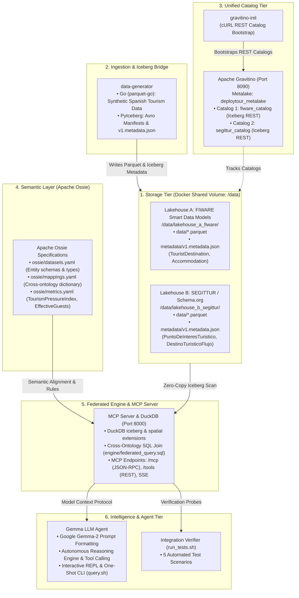

<!--
Copyright 2024-2026 Universidad Politécnica de Madrid / Deploytour

Licensed under the Apache License, Version 2.0 (the "License");
you may not use this file except in compliance with the License.
You may obtain a copy of the License at

    http://www.apache.org/licenses/LICENSE-2.0

Unless required by applicable law or agreed to in writing, software
distributed under the License is distributed on an "AS IS" BASIS,
WITHOUT WARRANTIES OR CONDITIONS OF ANY KIND, either express or implied.
See the License for the specific language governing permissions and
limitations under the License.
-->

# DEPLOYTOUR: Cross-Ontology Federation PoC & Gemma LLM Agent

A containerized, local-first semantic interoperability proof of concept (PoC) for the **DEPLOYTOUR** project. This system bridges Spanish tourism data stored across two independent Apache Iceberg data lakes representing disparate conceptual ontologies:

1. **Lakehouse A (FIWARE Smart Data Models):** Physical tourism supply and accommodation infrastructure (`TouristDestination`, `Accommodation`).
2. **Lakehouse B (SEGITTUR / Schema.org Semantics):** Tourism demand, points of interest, visitor flows, and footfall (`PuntoDeInteresTuristico`, `DestinoTuristicoFlujo`).

The platform integrates **Apache Gravitino**, **Apache Ossie (OSI)** semantics, **DuckDB** with native Iceberg scanning, the **Model Context Protocol (MCP)**, and an autonomous **Google Gemma LLM Agent** to query, reason over, and synthesize answers from the federated data without migrating or altering raw data sources.

---

## 1. Architectural Blueprint & Topology

The entire architecture is containerized using Docker Compose without requiring any local toolchains (no Go, Python, or DuckDB required on the host).



---

## 2. Detailed Component Breakdown

### 2.1 Storage & Ingestion Tier (`ingestion/`)
* **Technology:** Go (`parquet-go`) + PyIceberg bridge.
* **Role:** Generates synthetic, realistic Spanish tourism datasets across $>50$ municipalities (Madrid, Barcelona, Girona, Palma de Mallorca, Sevilla, Málaga, Valencia, etc.) with realistic spatial coordinates (WGS84) and INE codes.
* **Iceberg Metadata Compliance:**
  DuckDB's C++ Iceberg extension strictly validates Avro manifests, manifest lists, schema IDs, snapshot IDs, and partition specs. To ensure 100% specification compliance without external catalog daemons, `bridge_iceberg.py` leverages official `pyiceberg` libraries to write authentic `v1.metadata.json`, manifest lists, and manifest files directly to the local shared volume.

### 2.2 Catalog Federation Tier (`gravitino/`)
* **Technology:** Apache Gravitino `0.5.1` (`datastrato/gravitino:0.5.1`).
* **Role:** Acts as the centralized metadata and catalog governance authority.
* **Metalake & Catalogs:**
  1. `deploytour_metalake`: Top-level governance metalake.
  2. `fiware_catalog`: Filesystem-backed Iceberg catalog pointing to `/data/lakehouse_a_fiware`.
  3. `segittur_catalog`: Filesystem-backed Iceberg catalog pointing to `/data/lakehouse_b_segittur`.
* **Automated Bootstrap:** `gravitino-init` registers the metalake and both catalogs via Gravitino's REST API (`POST /api/v1/metalakes`) upon container startup.

### 2.3 Semantic Layer (`ossie/`)
* **Technology:** Apache Ossie (OSI) declarative semantic specifications.
* **Role:** Resolves structural and naming differences between disparate domain models without requiring ETL or schema transformation:
  - `ossie/datasets.yaml`: Declares physical fields, semantic concepts, and dimensions for `fiware_accommodations` and `segittur_destinos`.
  - `ossie/mappings.yaml`: Defines the cross-ontology dictionary. Maps FIWARE's `municipality_code` to SEGITTUR's `codigo_ine_municipio`, and aligns accommodation classes (`Hotel` $\leftrightarrow$ `AlojamientoHotelero`, `Camping` $\leftrightarrow$ `ZonaAcampada`).
  - `ossie/metrics.yaml`: Formalizes mathematical formulas for cross-lakehouse indicators:
    $$\text{TourismPressureIndex} = \frac{\sum(\text{visitantes\_mensuales})}{\sum(\text{capacity\_beds}) \times 30}$$

### 2.4 Federated Query Engine & MCP Server (`mcp_server/`, `engine/`)
* **Technology:** DuckDB with `iceberg` & `spatial` extensions + FastAPI / FastMCP.
* **Role:** Exposes analytical capabilities to AI agents and external tools via the **Model Context Protocol (MCP)**.
* **Exposed Endpoints & Protocols:**
  - `GET /health`: Healthcheck probe.
  - `POST /mcp`: Standard MCP JSON-RPC 2.0 protocol endpoint.
  - `GET /tools/{name}` & `POST /tools/{name}`: Direct REST invocation for all tools.
  - Server-Sent Events (SSE) support for streaming tool execution.
* **Exposed MCP Tools:**
  1. `list_semantic_entities`: Returns registered entities, metrics, and dimensions from Apache Ossie.
  2. `get_ontology_mappings`: Retrieves the cross-ontology alignment dictionary between FIWARE and SEGITTUR.
  3. `execute_federated_query`: Executes the cross-ontology join in DuckDB (`engine/federated_query.sql`) and returns structured JSON rows.
  4. `run_custom_duckdb_sql`: Allows executing arbitrary targeted SQL statements against `fiware_lake` and `segittur_lake` Iceberg views.

### 2.5 Intelligence Layer: Google Gemma LLM Agent (`gemma_agent/`)
* **Technology:** Python Gemma Agent supporting standard Gemma-2 instruction prompting and function calling.
* **Prompt Template:**
  ```text
  <start_of_turn>user
  You are an intelligent tourism analyst assistant powered by Google Gemma for the DEPLOYTOUR project.
  You have access to tools via the Model Context Protocol (MCP)...
  
  Available tools:
  - list_semantic_entities: ...
  - get_ontology_mappings: ...
  - execute_federated_query: ...
  - run_custom_duckdb_sql: ...
  
  User query: {user_query}
  <end_of_turn>
  <start_of_turn>model
  thought
  {reasoning}
  ```
* **Pluggability:**
  - Autonomous embedded reasoner for instant zero-dependency execution.
  - Fully compatible with external Gemma instances (e.g. Ollama via `LLM_BASE_URL=http://host.docker.internal:11434/v1`).

---

## 3. Execution & Deployment Modes

The repository provides a clean separation between **persistent infrastructure** and **on-demand user query scripts**.

```text
+----------------------------------------------------------------------------------+
|                               AVAILABLE RUN SCRIPTS                              |
+-------------------+--------------------------------------------------------------+
| Script            | Purpose                                                      |
+-------------------+--------------------------------------------------------------+
| ./start_infra.sh  | Starts core infrastructure (data, Gravitino, MCP) in the bg. |
| ./query.sh        | Runs Gemma Agent for ad-hoc queries or interactive REPL.     |
| ./run_tests.sh    | Runs the 5 automated test scenarios against running infra.   |
| ./run_duckdb_ossie_test.sh | Runs containerized test for native duckdb-ossie extension. |
| ./stop_infra.sh   | Tears down infrastructure containers and cleans volumes.    |
| ./run.sh          | Complete one-command CI/CD run (build, test, verify).        |
+-------------------+--------------------------------------------------------------+
```

### 3.1 Mode 1: Split Infrastructure & Gemma CLI (Recommended for Development)

#### Step 1: Start the Infrastructure
```bash
./start_infra.sh
```
*Outputs:*
- Parquet data & Iceberg metadata generated.
- Apache Gravitino running at `http://localhost:8090`.
- MCP Server & DuckDB running at `http://localhost:8000`.

#### Step 2: Query via Natural Language
```bash
# Ad-hoc one-shot query
./query.sh "Which municipality has the highest tourism pressure?"

# Specific municipality analysis
./query.sh "What is the tourism pressure in Madrid?"

# Comparative analysis
./query.sh "Compare Girona and Barcelona accommodation bed capacity."

# Semantic discovery
./query.sh "What datasets and metrics are registered in Apache Ossie?"

# Cross-ontology mapping details
./query.sh "How do FIWARE categories map to SEGITTUR spaces?"

# Overcapacity anomaly detection
./query.sh "Find municipalities where monthly visitors exceed bed capacity by more than 50 times."
```

#### Step 3: Interactive Gemma Session
Run without arguments to enter an interactive REPL:
```bash
./query.sh
```
```text
DEPLOYTOUR (Gemma Agent) > Compare Girona and Barcelona accommodation bed capacity.
```

#### Step 4: Run Tests & Stop
```bash
# Run test suite
./run_tests.sh

# Stop and clean up infrastructure
./stop_infra.sh
```

---

### 3.2 Mode 2: All-in-One Automated Pipeline (CI/CD)

Tear down previous state, build all images, run full verification across all layers, and assert exit code `0`:

```bash
./run.sh
```

---

### 3.3 Mode 3: Native `duckdb-ossie` Community Extension Evaluation

In addition to our production FastAPI/FastMCP server, we evaluated the official DuckDB community extension **`duckdb-ossie`** ([`iqea-ai/duckdb-ossie`](https://github.com/iqea-ai/duckdb-ossie)) alongside **`duckdb_mcp`** on git branch `feature/duckdb-ossie-test`.

This extension compiles Apache Ossie semantic models (`version: 0.2.0.dev0`) directly into DuckDB's C++ engine, exposing functions such as `ossie_load`, `ossie_datasets`, `ossie_fields`, `ossie_metrics`, `ossie_relationships`, `ossie_compile`, and `ossie_query`.

To run the containerized evaluation suite without installing DuckDB or local compilers:

```bash
./run_duckdb_ossie_test.sh
```

*What it validates inside Docker (`duckdb-ossie-tester`):*
1. **Extension Loading:** Installs and loads `ossie` and `duckdb_mcp` from DuckDB's community repository (`duckdb==1.5.5`).
2. **Schema Ingestion:** Initializes physical tables for FIWARE and SEGITTUR entities.
3. **C++ Model Parsing:** Loads [`ossie/duckdb_ossie_model.json`](file:///Users/jsalvachua/OntoDeployTour/ossie/duckdb_ossie_model.json).
4. **Metadata Discovery:** Introspects datasets, metrics, and foreign key relationships.
5. **Autonomous Query Compilation:** Compiles multi-grain SQL via `ossie_compile` and executes queries via `ossie_query`.
6. **Native MCP Publishing:** Exposes semantic tools and resources over MCP via `duckdb_mcp`.

For comprehensive benchmarks and architecture comparisons, refer to [DUCKDB_OSSIE_TEST.md](file:///Users/jsalvachua/OntoDeployTour/DUCKDB_OSSIE_TEST.md).

---

## 4. Documentation & Presentation Assets

* **[WORKFLOW.md](file:///Users/jsalvachua/OntoDeployTour/WORKFLOW.md):** Detailed end-to-end breakdown of the lifecycle of a query or problem, including sequence diagrams, intent parsing, semantic federation, and resilience checkpoints.
* **[TESTING.md](file:///Users/jsalvachua/OntoDeployTour/TESTING.md):** Deep-dive guide into cross-ontology join mechanics, SQL calculations, the 5 Gemma test scenarios, and the native `duckdb-ossie` test suite.
* **[DUCKDB_OSSIE_TEST.md](file:///Users/jsalvachua/OntoDeployTour/DUCKDB_OSSIE_TEST.md):** Dedicated technical evaluation report on the Iqea Technologies `duckdb-ossie` and `duckdb_mcp` community extensions.
* **[DEPLOYTOUR_PoC_Architecture_and_Testing.pptx](file:///Users/jsalvachua/OntoDeployTour/DEPLOYTOUR_PoC_Architecture_and_Testing.pptx):** Comprehensive 15-slide executive and technical PowerPoint presentation detailing the architecture, semantic alignment, verification results, query workflow, and `duckdb-ossie` evaluation.

---

## 5. Repository Structure

```text
OntoDeployTour/
├── docker-compose.yml              # Complete container topology (infra + agent + verifier + ossie-test)
├── start_infra.sh                  # Starts background services and waits for health checks
├── stop_infra.sh                   # Clean teardown of all containers and volumes
├── query.sh                        # Natural language CLI / REPL interface for Gemma Agent
├── run_tests.sh                    # Automated test runner against running infrastructure
├── run_duckdb_ossie_test.sh        # Containerized test runner for duckdb-ossie extension
├── run.sh                          # All-in-one CI/CD build & verify script
├── README.md                       # Comprehensive architecture and usage guide
├── WORKFLOW.md                     # Detailed query resolution and analytical problem-solving lifecycle
├── TESTING.md                      # Detailed test cases & cross-ontology query mechanics
├── DUCKDB_OSSIE_TEST.md            # duckdb-ossie community extension evaluation report
├── DEPLOYTOUR_...pptx              # PowerPoint presentation artifact (15 slides)
├── generate_presentation.py        # Automated pptx presentation generator script
├── engine/
│   └── federated_query.sql         # Core cross-ontology DuckDB SQL query
├── ossie/
│   ├── datasets.yaml               # Apache Ossie dataset definitions (FastMCP)
│   ├── mappings.yaml               # FIWARE <-> SEGITTUR cross-ontology alignments
│   ├── metrics.yaml                # Derived tourism metrics definitions
│   └── duckdb_ossie_model.json     # Native Apache Ossie JSON model (duckdb-ossie)
├── ingestion/
│   ├── main.go                     # Go synthetic data generator (parquet-go)
│   ├── bridge_iceberg.py           # PyIceberg metadata generator
│   └── Dockerfile                  # Ingestion container
├── gravitino/
│   └── init_catalogs.sh            # Bootstrap script for Gravitino REST catalogs
├── mcp_server/
│   ├── server.py                   # FastAPI / FastMCP server with DuckDB engine
│   └── Dockerfile                  # MCP server container
├── gemma_agent/
│   ├── agent.py                    # Gemma LLM Agent with Gemma-2 template & reasoning
│   ├── mcp_client.py               # MCP JSON-RPC client
│   ├── cli.py                      # Interactive & one-shot CLI entrypoint
│   ├── test_cases.py               # 5 automated test scenarios
│   └── Dockerfile                  # Gemma agent container
├── test/
│   ├── test_duckdb_ossie.py        # Python test runner for duckdb-ossie & duckdb_mcp
│   └── Dockerfile                  # Container packaging DuckDB 1.5.5 and cached extensions
└── verifier/
    ├── verify.py                   # End-to-end integration verifier
    └── Dockerfile                  # Verifier container
```
