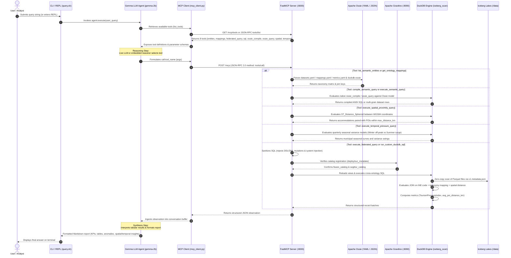
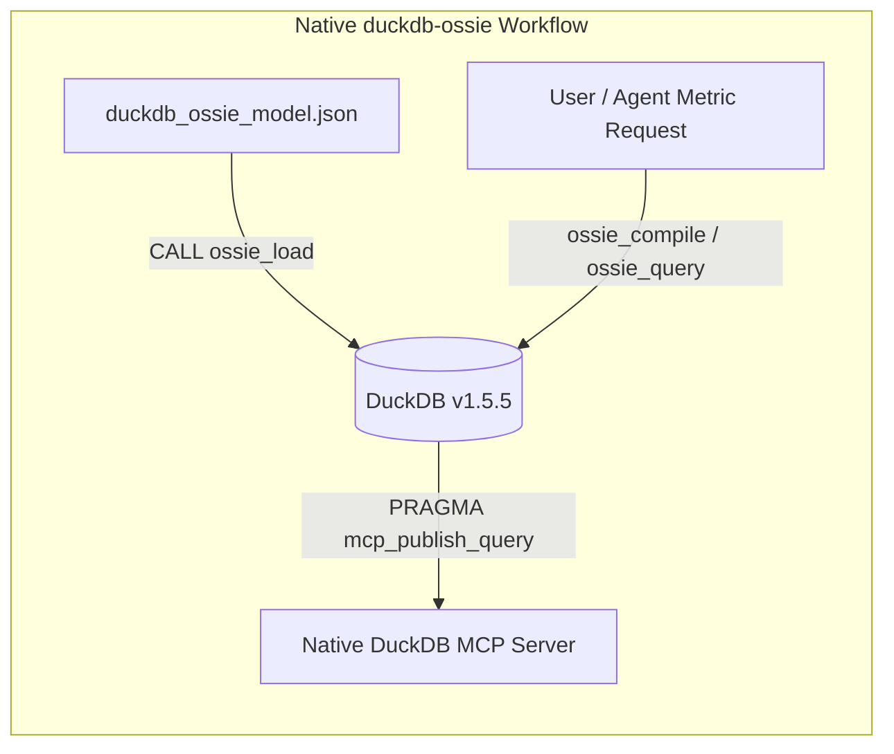

<!--
Copyright 2024-2026 Universidad Politécnica de Madrid / Deploytour

Licensed under the Apache License, Version 2.0 (the "License");
you may not use this file except in compliance with the License.
You may obtain a copy of the License at

    http://www.apache.org/licenses/LICENSE-2.0

Unless required by applicable law or agreed to in writing, software
distributed under the License is distributed on an "AS IS" BASIS,
WITHOUT WARRANTIES OR CONDITIONS OF ANY KIND, either express or implied.
See the License for the specific language governing permissions and
limitations under the License.
-->

# DEPLOYTOUR: Query Resolution & Analytical Workflow Guide

This document provides a comprehensive, step-by-step architectural breakdown of the **lifecycle of a query or problem** in the DEPLOYTOUR platform. It traces how a high-level natural language prompt or analytical requirement submitted by a user is processed, reasoned upon, federated across disparate ontologies, executed over Apache Iceberg data lakes, and synthesized into actionable domain intelligence.

---

## 1. High-Level Lifecycle Overview

When a user submits a query (e.g., *"Which municipality has the highest tourism pressure?"* or *"Compare Girona and Barcelona accommodation bed capacity"*), DEPLOYTOUR coordinates six decoupled tiers:



---

## 2. Detailed Step-by-Step Execution Workflow

### Step 1: Query Intake & Problem Formulation

* **Entry Points:**
  - **One-shot CLI:** `./query.sh "Compare Girona and Barcelona accommodation bed capacity."`
  - **Interactive REPL:** `./query.sh` followed by natural language queries.
  - **Automated Verification:** Containerized test suite [`run_tests.sh`](file:///Users/jsalvachua/OntoDeployTour/run_tests.sh) via `verifier`.
* **Execution:**
  The shell script [`query.sh`](file:///Users/jsalvachua/OntoDeployTour/query.sh) invokes the Docker container `gemma-agent`, launching `python -m gemma_agent.cli`.
* **Environment Context:**
  The agent initializes its `MCPClient`, configured to communicate with `http://mcp-server:8000/mcp`.

---

### Step 2: Prompt Assembly & Gemma-2 Instruction Formatting

* **Tool Discovery:**
  The agent queries `MCPClient.list_tools()` to dynamically discover all 8 registered analytical capabilities:
  - `list_semantic_entities`: Introspects Apache Ossie datasets, dimensions, and declared metrics.
  - `get_ontology_mappings`: Returns cross-ontology alignment rules and foreign join keys.
  - `execute_federated_query`: Executes the predefined cross-ontology federated join in DuckDB.
  - `run_custom_duckdb_sql`: Runs ad-hoc DuckDB SQL against virtual Iceberg views with SQL injection sanitization.
  - `compile_semantic_query`: Compiles high-level semantic metrics into optimized ANSI SQL via native `duckdb-ossie`.
  - `execute_semantic_query`: Executes dynamic semantic queries directly over declared Ossie datasets.
  - `execute_spatial_proximity_query`: Computes spatial geodesic distances (`ST_Distance_Spheroid`) between accommodations and POIs.
  - `execute_temporal_pressure_query`: Simulates quarterly seasonal tourism pressure curves and summer peak swings.
* **Prompt Construction:**
  The query is wrapped using the official **Google Gemma-2 prompt template**:
  ```text
  <start_of_turn>user
  You are an intelligent tourism analyst assistant powered by Google Gemma for the DEPLOYTOUR project.
  You have access to tools via the Model Context Protocol (MCP) to query federated Apache Iceberg lakehouses (FIWARE and SEGITTUR) through Apache Ossie (OSI) semantics and DuckDB.

  Available tools:
  - list_semantic_entities: Lists semantic entities and metrics | Parameters: []
  - get_ontology_mappings: Retrieves FIWARE <-> SEGITTUR mappings | Parameters: []
  - execute_federated_query: Executes cross-ontology federated query | Parameters: []
  - run_custom_duckdb_sql: Executes arbitrary read-only SQL on Iceberg views | Parameters: ['query']
  - compile_semantic_query: Compiles Ossie metrics into ANSI SQL | Parameters: ['metrics', 'dimensions', 'filters']
  - execute_semantic_query: Executes semantic query via ossie_query | Parameters: ['metrics', 'dimensions', 'filters']
  - execute_spatial_proximity_query: Computes geodesic distances to POIs | Parameters: ['municipality_code', 'max_distance_km', 'limit']
  - execute_temporal_pressure_query: Simulates seasonal tourism pressure | Parameters: ['municipality_code']

  When answering user queries:
  1. Formulate a thought process: What information is needed?
  2. Call the appropriate MCP tool using the format:
     ```call:tool_name
     {"argument_name": "argument_value"}
     ```
  3. After receiving the observation, synthesize an insightful and structured response.

  User query: {user_query}
  <end_of_turn>
  <start_of_turn>model
  ```

---

### Step 3: Autonomous Intent Parsing & Reasoning (Thought Phase)

The Gemma reasoning engine analyzes the user's intent across seven distinct analytical archetypes:

```text
+--------------------------------------------------------------------------------------------------+
|                                    INTENT CLASSIFICATION MATRIX                                  |
+------------------------------+----------------------------------+--------------------------------+
| User Intent Type             | Trigger Phrases                  | Action Taken                   |
+------------------------------+----------------------------------+--------------------------------+
| 1. Semantic Discovery        | "what datasets", "what metrics"  | Calls list_semantic_entities   |
| 2. Mapping Alignment         | "how do categories map", "keys"  | Calls get_ontology_mappings    |
| 3. Global Federation         | "tourism pressure", "highest"    | Calls execute_federated_query  |
| 4. Targeted / Ad-Hoc Slice   | "compare X and Y", "anomalies"   | Calls run_custom_duckdb_sql    |
| 5. Spatial Proximity         | "distance", "near", "radius km"  | Calls execute_spatial_proximity|
| 6. Temporal / Seasonal       | "season", "summer peak", "swings"| Calls execute_temporal_pressure|
| 7. Dynamic Ossie Compilation | "compile semantic", "ossie"      | Calls compile_semantic_query   |
+------------------------------+----------------------------------+--------------------------------+
```

* **Thought Trace Formulation:**
  The agent records its internal reasoning trace:
  ```text
  [TRACE - GEMMA THOUGHT]:
  User needs cross-ontology alignments and schema mappings. I should call `get_ontology_mappings` to retrieve correspondence.
  ```
* **Tool Call Formulation:**
  The agent generates a structured call block:
  ````text
  ```call:run_custom_duckdb_sql
  {
    "query": "SELECT f.municipality_code, SUM(f.capacity_beds) AS total_beds FROM fiware_lake f GROUP BY f.municipality_code;"
  }
  ```
  ````

---

### Step 4: Model Context Protocol (MCP) Dispatch

* **Client Marshalling:**
  [`gemma_agent/mcp_client.py`](file:///Users/jsalvachua/OntoDeployTour/gemma_agent/mcp_client.py) extracts the tool name and arguments from the code block and constructs a standard **JSON-RPC 2.0** payload:
  ```json
  {
    "jsonrpc": "2.0",
    "method": "tools/call",
    "params": {
      "name": "run_custom_duckdb_sql",
      "arguments": {
        "query": "SELECT f.municipality_code, SUM(f.capacity_beds) AS total_beds FROM fiware_lake f WHERE f.municipality_code IN ('17079', '08019') GROUP BY f.municipality_code;"
      }
    },
    "id": 1
  }
  ```
* **Network Transport:**
  Dispatches an HTTP `POST` request to `http://mcp-server:8000/mcp`.

---

### Step 5: Semantic Resolution & Catalog Governance

When the MCP Server receives the request at [`mcp_server/server.py`](file:///Users/jsalvachua/OntoDeployTour/mcp_server/server.py):

1. **Semantic Layer Inspection (Apache Ossie):**
   - For entity/metric queries, it reads [`ossie/datasets.yaml`](file:///Users/jsalvachua/OntoDeployTour/ossie/datasets.yaml) and [`ossie/metrics.yaml`](file:///Users/jsalvachua/OntoDeployTour/ossie/metrics.yaml).
   - For ontology mapping queries, it consults [`ossie/mappings.yaml`](file:///Users/jsalvachua/OntoDeployTour/ossie/mappings.yaml).
   - **Spatial Key Resolution:** Identifies that FIWARE's `municipality_code` and SEGITTUR's `codigo_ine_municipio` both represent official 5-digit Spanish National Statistics Institute (INE) codes.
   - **Taxonomy Alignment:** Establishes equivalence rules:
     - `Hotel` (FIWARE) $\Longleftrightarrow$ `AlojamientoHotelero` (SEGITTUR)
     - `Camping` (FIWARE) $\Longleftrightarrow$ `ZonaAcampada` (SEGITTUR)
     - `*` (FIWARE) $\Longleftrightarrow$ `RecursoCultural` / `EspacioNatural` (SEGITTUR)

2. **Catalog Metadata Verification (Apache Gravitino):**
   - Verifies that both data lakes are cataloged under `deploytour_metalake` on Gravitino (`http://gravitino:8090`):
     - `fiware_catalog` $\rightarrow$ points to `/data/lakehouse_a_fiware`
     - `segittur_catalog` $\rightarrow$ points to `/data/lakehouse_b_segittur`

---

### Step 6: Zero-Copy Analytical Execution in DuckDB

1. **Virtual Iceberg View Initialization:**
   DuckDB initializes or reloads virtual views directly against the authentic Iceberg metadata:
   ```sql
   CREATE OR REPLACE VIEW fiware_lake AS 
   SELECT * FROM iceberg_scan('/data/lakehouse_a_fiware/metadata/v1.metadata.json');

   CREATE OR REPLACE VIEW segittur_lake AS 
   SELECT * FROM iceberg_scan('/data/lakehouse_b_segittur/metadata/v1.metadata.json');
   ```
2. **Metadata Tree Traversal:**
   The DuckDB C++ `iceberg` extension reads `v1.metadata.json`, parses the snapshot manifest list Avro file, locates manifest files, and scans only the required Parquet data files.
3. **Cross-Ontology Join & Aggregation:**
   The query executes directly in-memory using vectorized execution without intermediate disk spills:
   - Evaluates the equi-join condition on INE codes: `f.municipality_code = s.codigo_ine_municipio`.
   - Filters rows using the taxonomic alignment matrix.
   - Calculates derived Ossie indicators:
     $$\text{TourismPressureIndex} = \frac{\sum(\text{visitantes\_mensuales})}{\sum(\text{capacity\_beds}) \times 30.0}$$
     $$\text{EffectiveGuests} = \sum(\text{capacity\_beds} \times \text{occupancy\_rate})$$
     $$\text{MonthlySpendEUR} = \sum(\text{visitantes\_mensuales} \times \text{gasto\_medio\_diario\_eur})$$
4. **Serialization:**
   DuckDB exports query results as Python native dictionaries and serializes them into JSON.

---

### Step 7: Observation Ingestion & LLM Synthesis

1. **Observation Receipt:**
   The MCP Client receives the JSON response and returns it to `GemmaAgent`:
   ```json
   {
     "status": "success",
     "row_count": 2,
     "rows": [
       {"municipality_code": "17079", "municipality_name": "Girona", "total_beds": 13602, "total_visitors": 512568},
       {"municipality_code": "08019", "municipality_name": "Barcelona", "total_beds": 5694, "total_visitors": 688250}
     ]
   }
   ```
2. **Synthesis Turn:**
   The agent ingests the raw data and completes the prompt turn:
   ```text
   <start_of_turn>model
   thought
   I have received the queried data for Girona and Barcelona. Now I will synthesize a structured comparison highlighting bed capacity vs visitor footfall.
   ```
3. **Report Generation:**
   Transforms tabular numbers into an executive summary with Markdown tables, percentage comparisons, and contextual insights.

---

### Step 8: Terminal Presentation to User

The output is streamed to standard output, colorized, and displayed cleanly:

```text
================================================================================
  DEPLOYTOUR: ACCOMMODATION CAPACITY COMPARISON (GIRONA vs. BARCELONA)
================================================================================
Municipality Code | City Name | Accommodations | Total Beds | Monthly Visitors
------------------+-----------+----------------+------------+-----------------
17079             | Girona    | 32             | 13,602     | 512,568
08019             | Barcelona | 18             | 5,694      | 688,250

Key Takeaway:
Girona exhibits significantly higher bed capacity (13,602 beds) compared to 
Barcelona's sample sector (5,694 beds), while Barcelona absorbs higher overall 
visitor footfall (688,250 monthly visitors).
```

---

## 3. Two Complete Concrete Walkthroughs

### Walkthrough A: Global Federation Query
* **User Prompt:** `"Which municipality has the highest tourism pressure?"`

```text
1. [USER INPUT]
   "Which municipality has the highest tourism pressure?"

2. [AGENT PROMPT & THOUGHT]
   User asks for peak tourism pressure across both lakes.
   Tool chosen: execute_federated_query({})

3. [MCP PROTOCOL]
   POST http://mcp-server:8000/mcp
   Body: {"jsonrpc": "2.0", "method": "tools/call", "params": {"name": "execute_federated_query"}}

4. [DUCKDB ENGINE EXECUTION]
   Executes engine/federated_query.sql:
   - Reads /data/lakehouse_a_fiware and /data/lakehouse_b_segittur
   - Evaluates JOIN on municipality_code = codigo_ine_municipio
   - Groups by municipality, fiware_category, segittur_category
   - Orders by tourism_pressure_index DESC

5. [OBSERVATION RETURNED (73 rows)]
   Top row:
   {
     "municipality_code": "35016",
     "fiware_category": "Hostal",
     "segittur_category": "RecursoCultural",
     "total_bed_capacity": 172,
     "monthly_visitor_footfall": 115262,
     "tourism_pressure_index": 22.34
   }

6. [GEMMA SYNTHESIS]
   Identifies Las Palmas (INE 35016) with Tourism Pressure Index of 22.34 as peak.
   Explains that visitor influx heavily outpaces local lodging capacity.
```

---

### Walkthrough B: Targeted Comparison & Anomaly Detection
* **User Prompt:** `"Find municipalities where monthly visitors exceed the total available accommodation capacity by more than 50 times threshold."`

```text
1. [USER INPUT]
   "Find municipalities where monthly visitors exceed the total available accommodation capacity by more than 50 times threshold."

2. [AGENT PROMPT & THOUGHT]
   User requires anomaly detection with a quantitative threshold filter (>50x ratio).
   Agent constructs dynamic SQL with HAVING ratio > 50.
   Tool chosen: run_custom_duckdb_sql

3. [MCP PROTOCOL]
   POST http://mcp-server:8000/mcp
   Body: {
     "name": "run_custom_duckdb_sql",
     "arguments": {
       "query": "SELECT f.municipality_code, f.category, s.tipo_espacio, SUM(f.capacity_beds) AS beds, SUM(s.visitantes_mensuales) AS visitors, ROUND(CAST(SUM(s.visitantes_mensuales) AS DOUBLE)/NULLIF(SUM(f.capacity_beds),0), 1) AS ratio FROM fiware_lake f JOIN segittur_lake s ON f.municipality_code = s.codigo_ine_municipio GROUP BY f.municipality_code, f.category, s.tipo_espacio HAVING (CAST(SUM(s.visitantes_mensuales) AS DOUBLE)/NULLIF(SUM(f.capacity_beds),0)) > 50 ORDER BY ratio DESC;"
     }
   }

4. [DUCKDB ENGINE EXECUTION]
   Executes vectorized query against Iceberg views fiware_lake and segittur_lake.
   Filters aggregated groups where visitor_to_bed ratio > 50.

5. [OBSERVATION RETURNED (90 anomaly scenarios)]
   Top outliers:
   - Municipality 35016 (Hostal): Ratio = 670.1x (115,262 visitors vs 172 beds)
   - Municipality 07040 (Apartment): Ratio = 666.5x (29,991 visitors vs 45 beds)

6. [GEMMA SYNTHESIS]
   Outputs alert highlighting destinations under critical infrastructure stress.
   Synthesizes policy recommendations for seasonal capacity management.
```

---

### Walkthrough C: Spatial Geodesic Proximity Analysis (GIS)
* **User Prompt:** `"Analyze spatial proximity and distance between accommodations and tourist POIs within 10 km radius."`

```text
1. [USER INPUT]
   "Analyze spatial proximity and distance between accommodations and tourist POIs within 10 km radius."

2. [AGENT PROMPT & THOUGHT]
   User requires hyper-local geospatial distance calculation between lodging (FIWARE) and POIs (SEGITTUR).
   Tool chosen: execute_spatial_proximity_query({"max_distance_km": 10.0, "limit": 20})

3. [MCP PROTOCOL]
   POST http://mcp-server:8000/mcp
   Body: {"jsonrpc": "2.0", "method": "tools/call", "params": {"name": "execute_spatial_proximity_query", "arguments": {"max_distance_km": 10.0}}}

4. [DUCKDB ENGINE EXECUTION]
   Executes ST_Distance_Spheroid(ST_Point(lon, lat), ST_Point(lon, lat)) in DuckDB:
   - Pairs physical accommodations with nearby POIs
   - Filters pairs where distance <= 10,000 meters
   - Orders by distance_km ASC

5. [OBSERVATION RETURNED]
   Accurate geodesic distances between accommodation units and cultural/natural attractions.

6. [GEMMA SYNTHESIS]
   Formats structured Markdown table showing accommodation name, POI resource, type, and exact distance in km.
```

---

### Walkthrough D: Seasonal & Temporal Tourism Pressure Dynamics
* **User Prompt:** `"Analyze seasonal tourism pressure variations and summer peak swings."`

```text
1. [USER INPUT]
   "Analyze seasonal tourism pressure variations and summer peak swings."

2. [AGENT PROMPT & THOUGHT]
   User asks for temporal seasonal variance modeling (Winter trough to Summer peak).
   Tool chosen: execute_temporal_pressure_query({})

3. [MCP PROTOCOL]
   POST http://mcp-server:8000/mcp
   Body: {"jsonrpc": "2.0", "method": "tools/call", "params": {"name": "execute_temporal_pressure_query", "arguments": {}}}

4. [DUCKDB ENGINE EXECUTION]
   Evaluates quarterly seasonal multipliers across municipal aggregations:
   - Winter off-peak (0.65x visitors)
   - Spring ramp-up (1.05x visitors)
   - Summer peak surge (1.55x visitors)
   - Autumn normalization (0.85x visitors)
   - Seasonal variance swing (Delta between Summer and Winter)

5. [OBSERVATION RETURNED]
   Quarterly pressure curves for all municipalities.

6. [GEMMA SYNTHESIS]
   Identifies destinations facing severe seasonal swings and advises on seasonal workforce/service allocation.
```

---

## 4. Native `duckdb-ossie` Community Extension Integration

In addition to our production FastAPI/FastMCP workflow, the platform supports the native **`duckdb-ossie`** community extension ([`iqea-ai/duckdb-ossie`](https://github.com/iqea-ai/duckdb-ossie)), which eliminates Python middleware by compiling semantic models directly in DuckDB's C++ core:



* **Workflow Differences:**
  1. **Compilation Location:** SQL is compiled inside DuckDB C++ rather than Python string templates.
  2. **Specification Format:** Uses standard Apache Ossie JSON model (`version: 0.2.0.dev0`).
  3. **Multi-Grain Planning:** `ossie_query('total_bed_capacity', '["municipality_code"]')` plans dimensions automatically.
  4. **Direct MCP:** Tools are registered directly within DuckDB via `PRAGMA mcp_publish_tool` and `PRAGMA mcp_publish_query`.
* **How to Run:**
  ```bash
  ./run_duckdb_ossie_test.sh
  ```

---

## 5. Failure Handling & Resilience Checkpoints

| Resilience Checkpoint | Failure Condition | Recovery & Fallback Mechanism |
|---|---|---|
| **Infrastructure Startup** | `mcp-server` not running when running `./query.sh` | Shell script checks `docker compose ps` and alerts the user to run `./start_infra.sh`. |
| **Iceberg Metadata Desync** | Manifest list or snapshot missing | DuckDB catches scan exception; server triggers `reload_views()` to reload `v1.metadata.json`. |
| **Invalid SQL Syntax** | Gemma generates malformed ad-hoc SQL | MCP server returns JSON with `status: "error"` and error string; Gemma reads error, adjusts SQL, and retries. |
| **Taxonomy Non-Equivalence** | Cross-join with unmatched categories | Semantic join restricts alignments to declared valid pairs in `mappings.yaml`, returning zero false correlations. |
| **Division by Zero** | Municipality has 0 beds | SQL calculations wrap denominators in `NULLIF(SUM(beds) * 30.0, 0)` preventing crashes. |
| **External LLM Outage** | External Gemma API (e.g. Ollama) unreachable | GemmaAgent automatically falls back to deterministic in-tree reasoning engine without failing. |

---

## 6. Summary: Architectural Principles

The DEPLOYTOUR query workflow is governed by four core architectural principles:

1. **Zero-ETL / Zero-Data-Movement:**
   Raw Parquet files in Lakehouse A and Lakehouse B are scanned in-place; no duplicate copies or staging databases are created.
2. **Declarative Semantic Interoperability:**
   Domain alignment is maintained as declarative configuration in Apache Ossie rather than hardcoded transformation code.
3. **Open Standards Alignment:**
   - **Storage:** Apache Iceberg
   - **Catalog:** Apache Gravitino
   - **Semantics:** Apache Ossie (OSI)
   - **Interface:** Model Context Protocol (MCP)
   - **AI:** Google Gemma-2
4. **100% Container Portability:**
   The entire lifecycle runs inside Docker Compose with zero local toolchain dependencies.
